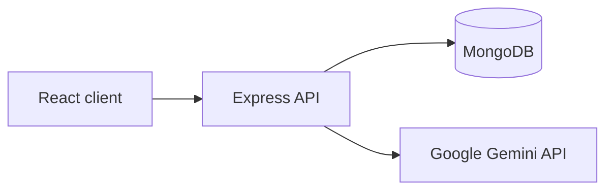

# CareTrack

CareTrack is a responsive MERN warranty claim application. Customers register, submit a product issue with a receipt, and follow its status. Admins review claims, read an optional Gemini assessment, add notes, and advance the workflow.

Warranty teams often receive claims through scattered email and files. CareTrack puts the receipt, issue, customer, assessment, and status history in one record. Gemini helps triage issues; **its output is advisory and never approves or rejects a claim**.

## Features

- Customer registration, login, claim submission, search, status filtering, and timeline
- Admin claim search, status and AI priority filtering, receipt access, notes, and sequential status updates
- Server-side pagination, MongoDB receipt storage, protected role-based APIs
- Responsive desktop tables and mobile cards; full-width mobile drawers
- Structured Gemini assessments that run after submission and can be retried by an admin without losing a claim
- Admin-issued reimbursement pickup vouchers with customer instructions, PDF download, code verification, and collection recording

## Stack and architecture

React, Vite, TypeScript, Ant Design, React Router, TanStack Query, and Axios power the client. Express, TypeScript, Mongoose, JWT, bcrypt, Zod, and Multer power the API. MongoDB stores users, claims, and receipt bytes.



See [architecture](docs/architecture.md), [API reference](docs/api.md), [database design](docs/database-design.md), [reimbursement flow](docs/reimbursement-flow.md), and [deployment instructions](docs/deployment.md).

## Local setup

Use Node.js 20.19+ or 22.12+ and a reachable MongoDB instance (local or Atlas).

```bash
cd caretrack
npm install
cp server/.env.example server/.env
cp client/.env.example client/.env
```

Set `MONGODB_URI` to your MongoDB connection string, `JWT_SECRET` to a random secret of at least 32 characters, and optionally `GEMINI_API_KEY` and `GEMINI_MODEL`. Set `PICKUP_ADDRESS` to a clearly fictional demonstration address for reimbursement vouchers; a mock address is used by default. The client only needs `VITE_API_BASE_URL`; it must point to the API's `/api` path. `CLIENT_URL` is the allowed frontend origin for CORS. `PORT` defaults to 5000. Never commit `.env` files.

For Atlas, create a cluster, a database user, and an appropriate network access rule, then copy the driver URI into `server/.env`. Use a dedicated database for this project.

To create the first admin, set `ADMIN_NAME`, `ADMIN_EMAIL`, and `ADMIN_PASSWORD` in `server/.env` and run:

```bash
npm run seed:admin
```

The seed refuses an email that already exists. Public registration creates customers only. For demo accounts, register a customer in the UI and seed a separate admin with credentials you manage; no passwords are shipped in the repo.

Run both apps:

```bash
npm run dev
```

Open `http://localhost:5173`. You can also run `npm run dev -w server` and `npm run dev -w client` separately.

## Verification

```bash
npm test
npm run build
```

`npm test` runs backend API and AI service tests with mocked persistence and Gemini responses. `npm run build` checks backend TypeScript and builds the Vite client. Live MongoDB and Gemini smoke checks require your own credentials.

## Deployment

Deploy `client/` to Vercel (Vite build command `npm run build`, output `dist`) and `server/` to Render (Node build `npm install && npm run build`, start `npm start`). Configure `VITE_API_BASE_URL` in Vercel as `https://YOUR-RENDER-HOST/api`; configure `CLIENT_URL` in Render as the exact Vercel origin. Add the MongoDB Atlas URI, JWT secret, and optional Gemini variables to Render. Seed the admin with a one-time Render shell or a local environment pointed at Atlas. See [deployment instructions](docs/deployment.md).

## Limits and next steps

Receipts are capped at 5 MB and stored in MongoDB for this proof of concept. Claim submission returns after persistence while Gemini analysis continues in the API process with a 45-second timeout. The client polls pending assessments. A process restart can interrupt in-flight analysis; an admin can retry a failed, unavailable, legacy, or stale pending assessment from the claim drawer. The reimbursement flow uses a fictional address and staff attestation; it sends no email or money. Authentication uses a one-day JWT in session storage; production hardening could move to HTTP-only cookies with refresh rotation. Search uses escaped, case-insensitive regex suitable for modest datasets; larger deployments should add dedicated search indexes. Future work could add object storage, email notifications, a warranty rule engine, richer analytics, and expanded audit logs.
