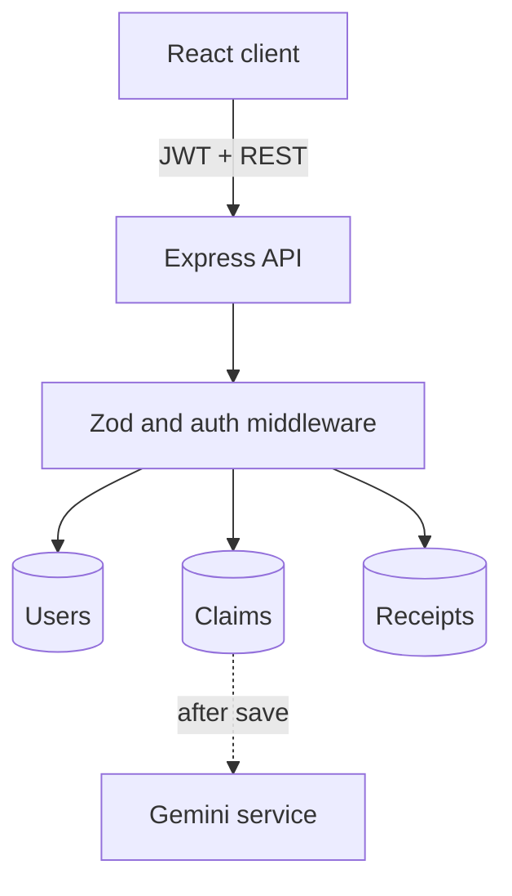

# Architecture

The Vite client calls the Express JSON API through Axios. JWTs are sent in the `Authorization` header and kept in browser session storage. `/api/auth/me` verifies a restored session; protected routes redirect by role. TanStack Query caches claim lists and details and invalidates them after a mutation.

The API validates bodies and queries with Zod and file uploads with Multer plus byte signatures. Claims reference a customer and a receipt document. Receipt bytes are fetched only from the dedicated authorization-checked endpoint. Admin status changes append a timestamped history item. A shared error handler returns safe, consistent JSON errors.

An admin can issue a reimbursement voucher from an under-review or in-progress claim. Issuance and collection use conditional database updates so duplicate actions do not create another voucher or record collection twice. The customer sees instructions and downloads a PDF generated from the saved voucher data. Admin staff enter the code from the voucher and attest that they checked the original receipt and handed over payment; that action marks the claim resolved. The address and payment handover are a demonstration workflow, with no electronic funds transfer.

Creation order is receipt → claim → immediate `201` response → optional Gemini analysis. If claim persistence fails, the new receipt is removed. Assessment state is persisted as pending, completed, failed, or unavailable, and the client polls while it is pending. If Gemini fails or returns malformed output, the persisted claim remains available without AI data. Work runs in the API process; a restart during analysis can leave a claim pending.

