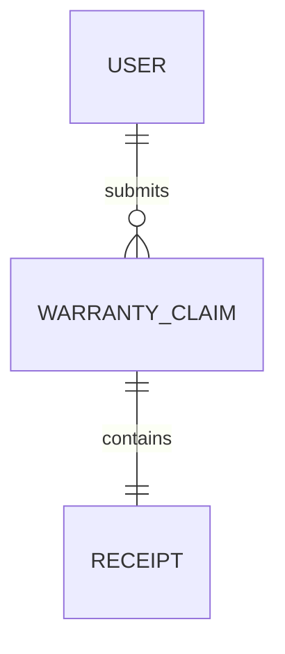

# Database design

`User`: full name, unique lowercase email, selected password hash, role (`CUSTOMER` or `ADMIN`), timestamps. Password hashes are excluded from normal queries and API responses.

`WarrantyClaim`: unique claim number, customer and receipt references, product details, purchase date, issue description, one of four statuses, optional admin note, optional validated AI assessment, optional reimbursement, status history, timestamps. `statusHistory` records status, time, and actor. The embedded reimbursement stores approved amount in minor currency units, currency, unique voucher code, mock pickup address, `READY_FOR_COLLECTION` or `COLLECTED` state, issue and collection actors/times, and original receipt verification time. The PDF is generated from these saved fields when downloaded.

`Receipt`: original name, generated filename, MIME type, size, binary data, creation time. Binary data is excluded from normal selects.

Indexes cover unique email, claim number, and voucher code; customer ID, status, creation time, and AI priority. Search uses length-limited, regex-escaped input. This favors clarity for a small application; use a search index for large datasets.
